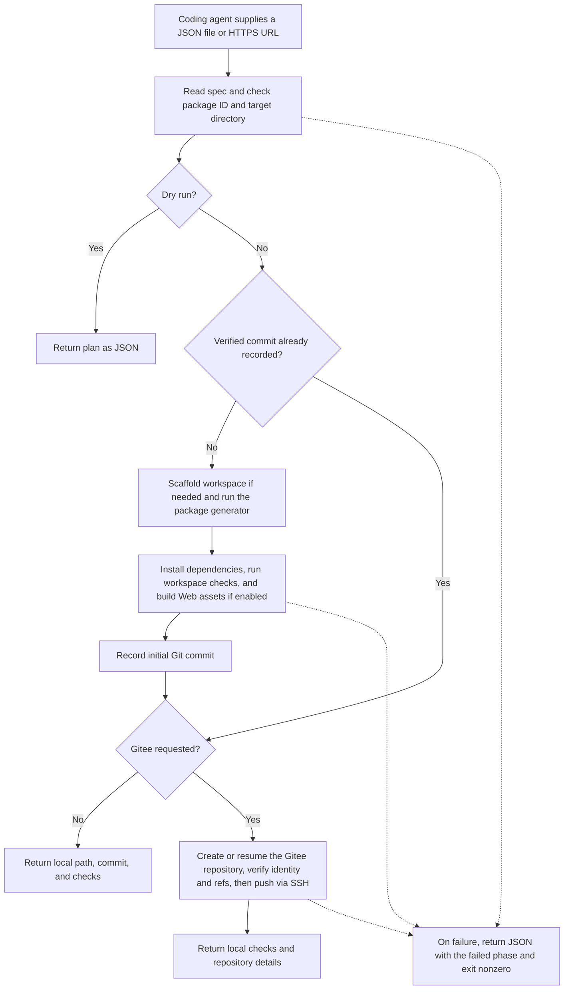
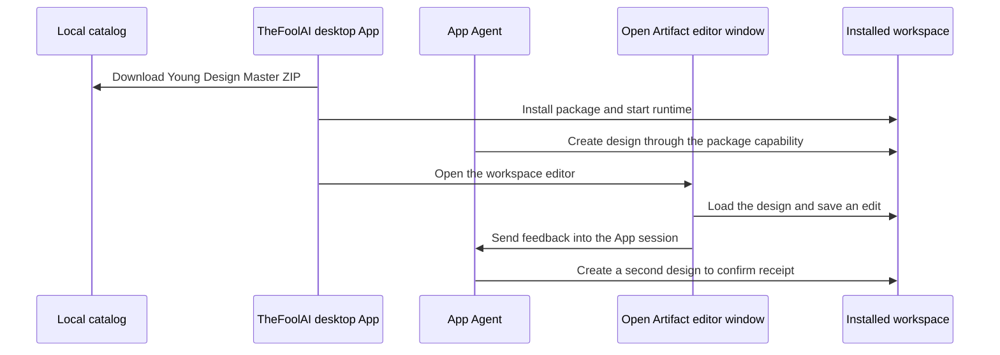

## Decisions

- Use the existing scaffold and package generator without invoking a second CLI for the outer workspace.
- Accept JSON from disk or HTTPS and pass a copy of the validated input to the generator.
- Validate the standalone project before remote writes. Use Gitee's enterprise API to create an empty repository and standard Git for SSH transport.
- Persist the spec digest in the source repository and the Gitee operation identity in local Git configuration. Check ownership and refs before retrying writes.
- Keep the Open Artifact integration in the generated product repository and verify its installed behavior in TheFoolAI.

## Creation flow

## Local desktop acceptance

## Field evaluation (2026-11-19)

| Observation                                                                                                                                                                       | Change and verification                                                                                                                                                                                                                                                                                |
| --------------------------------------------------------------------------------------------------------------------------------------------------------------------------------- | ------------------------------------------------------------------------------------------------------------------------------------------------------------------------------------------------------------------------------------------------------------------------------------------------------ |
| Seven generator tests failed inside the populated Young Design Master repository because their fixture copied the product and expected an empty Web slot.                         | Run empty-template tests in AgentDock CI. Keep workspace-local tests in generated products and run them during creation.                                                                                                                                                                               |
| A spec with just a valid ID could receive a successful dry run, then fail after scaffolding. An approved no-Web package also inherited a check for an uninstalled Web dependency. | Validate the spec before creating the directory. Use the no-Web workspace check for the default headless scaffold. The npm candidate created both the original Web spec and an approved headless variant from scratch.                                                                                 |
| Comparing generated standards locks against the two standards checkouts found three stale digests, including web-scaffold 0.5.2.                                                  | Sync the pins and the host appearance message handler. Run the parity test against TheFoolAI `de9c694e` and domain-packages `1b8a1edf`.                                                                                                                                                                |
| A build alone could not establish that the App could install the product, route comments or export a design.                                                                      | The public OSS manifest matched the 19,571,498-byte download. All 551 file contents matched the local acceptance ZIP. A compatible isolated Electron host installed it through the paginated catalog, opened all seven editor types, completed the Agent comment round trip and exported a design ZIP. |

Gitee coverage used simulated API and Git responses. Creating a live enterprise repository was outside this release check. Electron interaction coverage used the host with the editor bridge changes. Only the design editor received the complete editing and export exercise.
